<div align="center">


# الرائد للصرافة — Al Raed Exchange

**ثقة • سرعة • أمان**

نظام إدارة الحوالات والصرافة: موقع للعملاء ولوحة إدارة للموظفين،
من استقبال الطلب حتى التسليم وإثباته.


</div>

<div dir="rtl">

## المحتويات

- [نظرة عامة](#نظرة-عامة)
- [لقطات من النظام](#لقطات-من-النظام)
- [كيف يعمل النظام](#كيف-يعمل-النظام)
- [الأدوار والصلاحيات](#الأدوار-والصلاحيات)
- [قواعد الحماية](#قواعد-الحماية)
- [التقنيات](#التقنيات)
- [التشغيل على جهازك](#التشغيل-على-جهازك)
- [أوامر الإدارة](#أوامر-الإدارة)
- [النشر](#النشر)
- [بنية المشروع](#بنية-المشروع)
- [ما لم يُبنَ بعد](#ما-لم-يُبنَ-بعد)

## نظرة عامة

يستقبل المكتب حوالات من دول وخدمات كثيرة (USDT، وPayPal، والأردن، ومصر، وأوروبا، وتركيا، وسوريا، والحوالات الدولية) ويسلّمها في غزة عبر البنوك والمحافظ والنقد. كانت المتابعة تتم يدويًا عبر واتساب، والنظام يحوّلها إلى دورة واضحة:

- **الموقع العام** يعرض الخدمات، ويستقبل طلبات الحوالة برقم مرجعي، ويتيح للعميل متابعة طلبه.
- **لوحة الإدارة** يحوّل فيها الموظف الطلب إلى حوالة، فتمرّ بالتسعير ثم الوصولات ثم التشييك ثم الاعتماد ثم التسليم، ولكل خطوة دور مسؤول وسجل لا يُعدَّل.
- **لا يُعتمد أي مبلغ بناءً على صورة الإيصال وحدها**، ولا يُسلَّم شيء قبل التحقق من وصول المال فعلًا.

## لقطات من النظام

> اللقطات من نسخة تشغيل محلية ببيانات تجريبية (`php artisan alraed:demo-data`). كل الأسماء والأرقام والحسابات فيها وهمية.

### الموقع العام

<p align="center">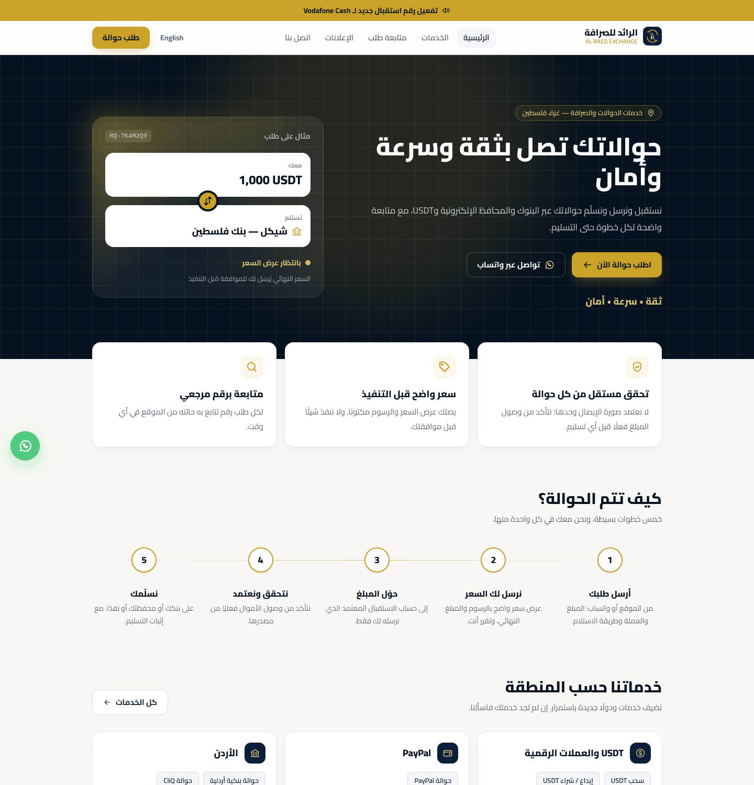</p>

<table>
<tr>
<td width="50%">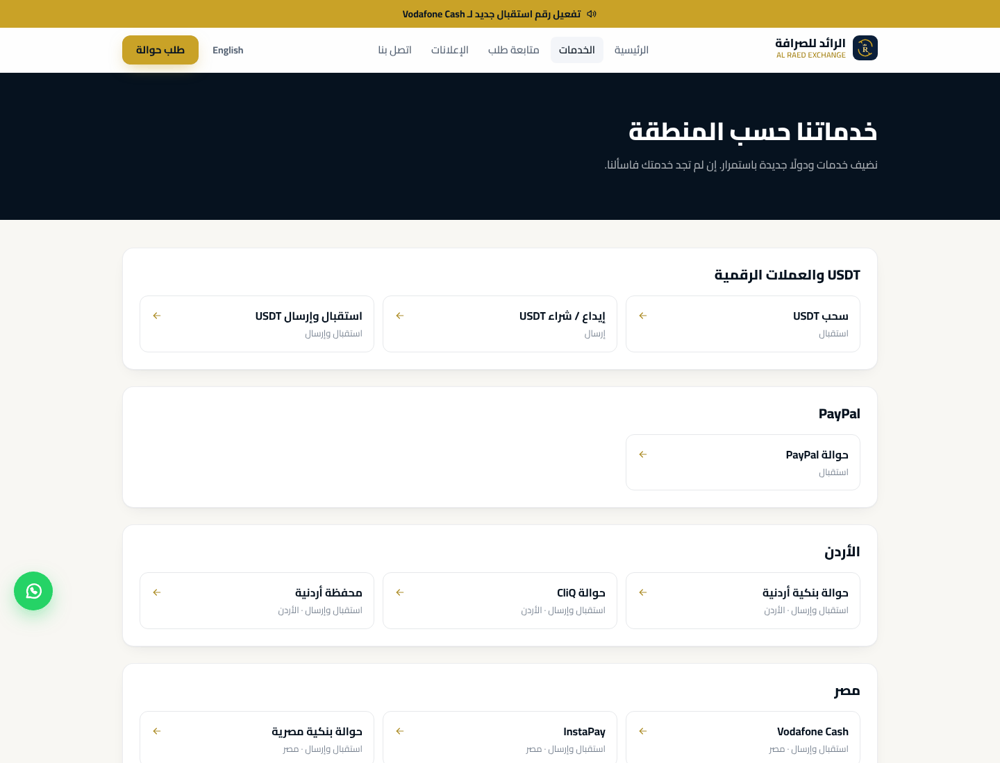<br><sub>الخدمات حسب المنطقة، وكل خدمة تفتح نموذج الطلب</sub></td>
<td width="50%">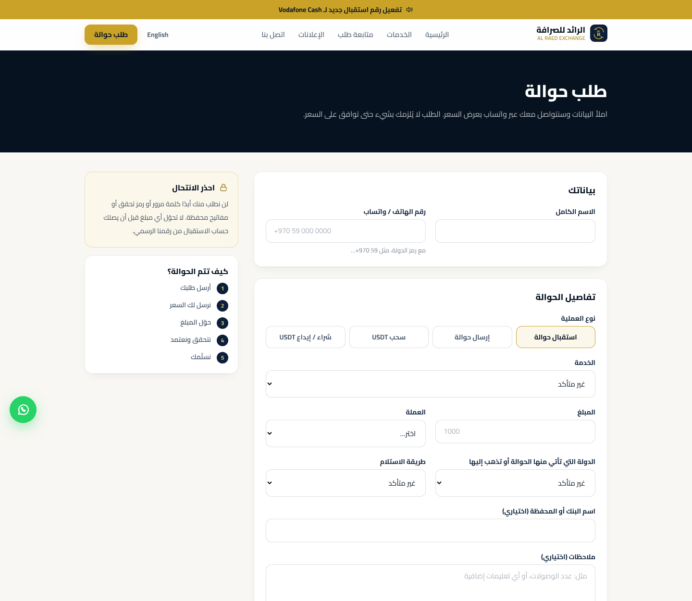<br><sub>نموذج طلب الحوالة مع تنبيهات الأمان</sub></td>
</tr>
</table>

<table>
<tr>
<td width="50%" align="center"><br><sub>الرئيسية على الهاتف، مع شريط تنبيه مثبّت</sub></td>
<td width="50%" align="center">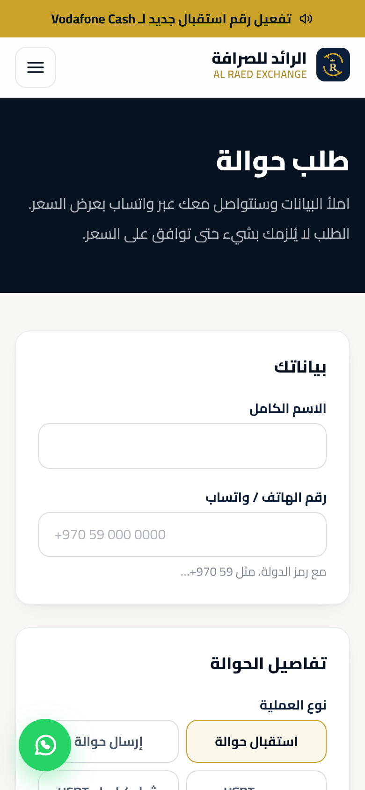<br><sub>نموذج الطلب على الهاتف</sub></td>
</tr>
</table>

### لوحة الإدارة

<p align="center">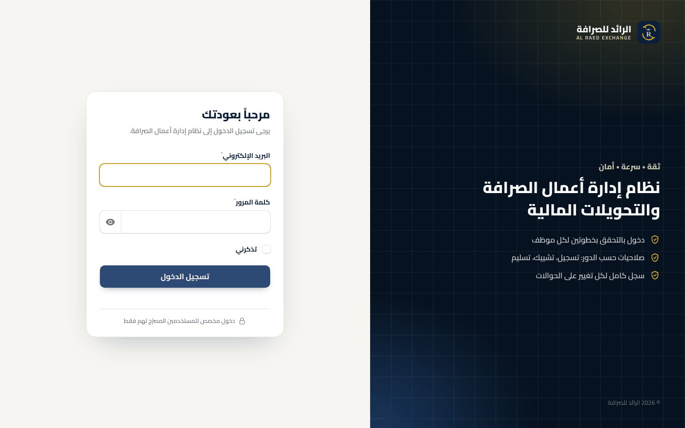<br><sub>تسجيل الدخول، يليه التحقق بخطوتين إلزاميًا</sub></p>

<p align="center">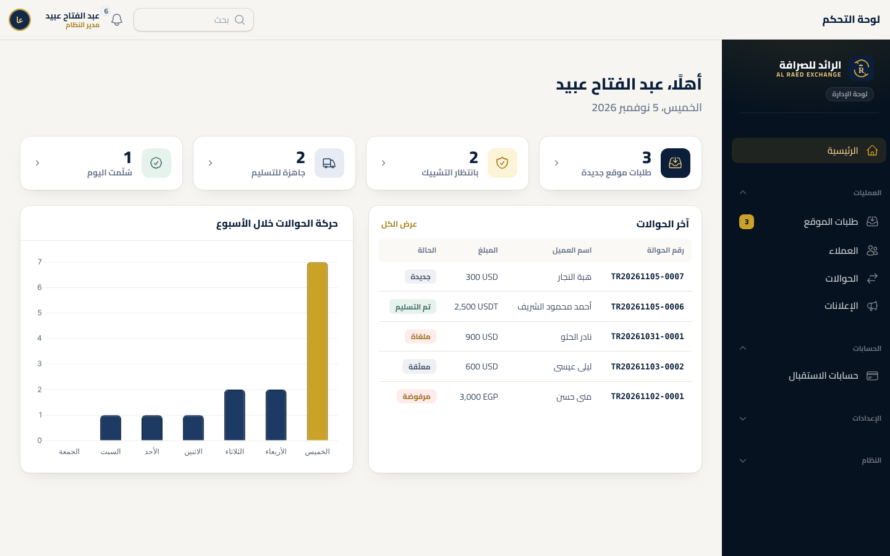<br><sub>الرئيسية: ما يحتاج إجراءً الآن، وكل بطاقة تفتح القائمة المفلترة</sub></p>

<table>
<tr>
<td width="50%">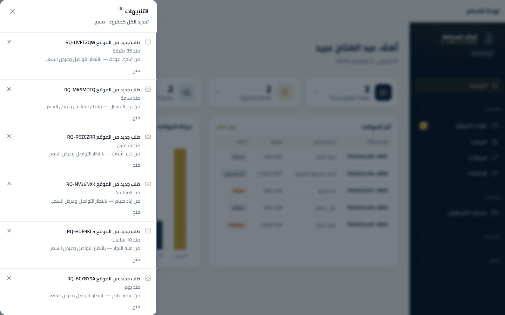<br><sub>الإشعارات تصل لمن عليه الخطوة التالية</sub></td>
<td width="50%">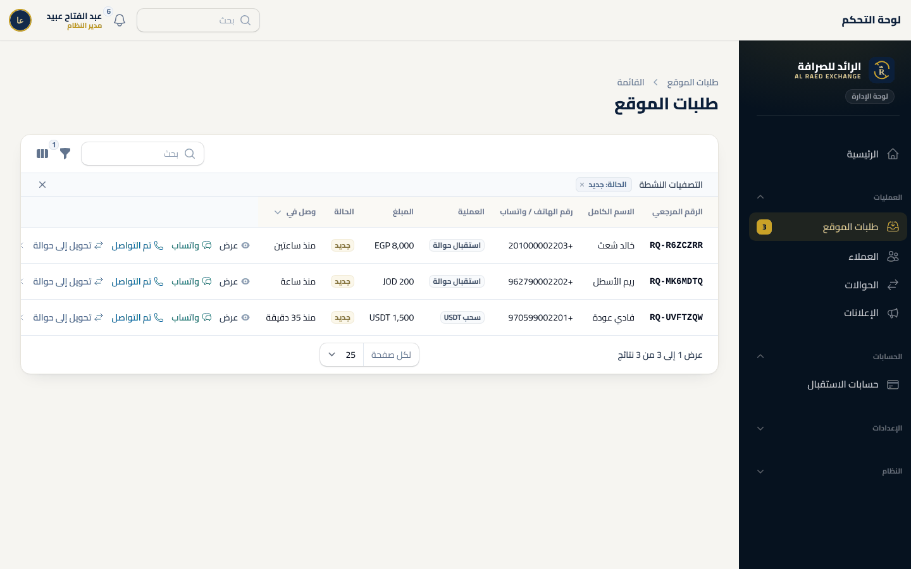<br><sub>طلبات الموقع: تواصل، ثم تحويل إلى حوالة بضغطة</sub></td>
</tr>
<tr>
<td width="50%">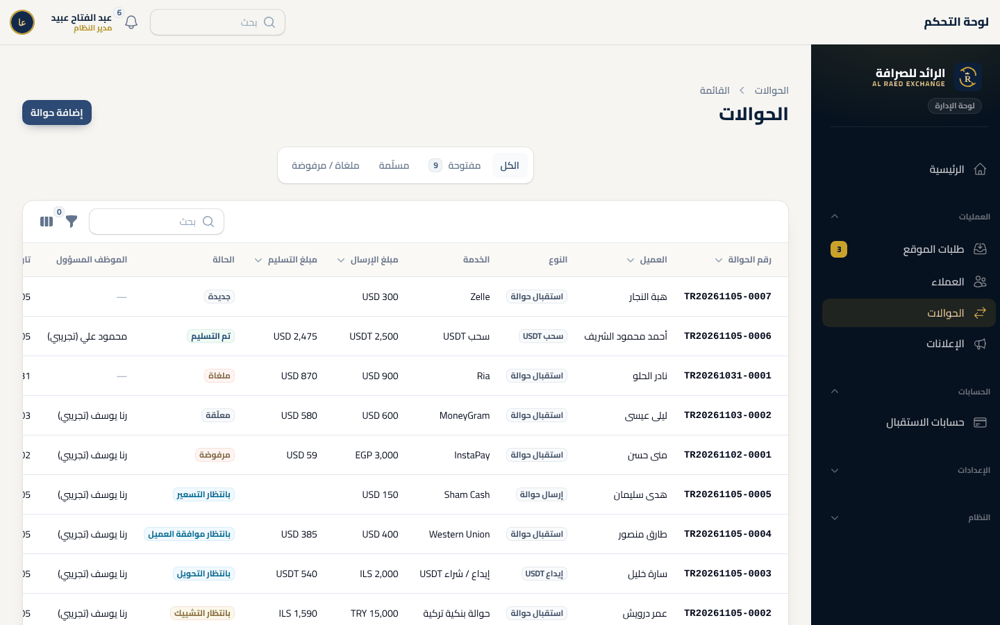<br><sub>الحوالات مع تبويبات المفتوحة والمسلّمة والملغاة</sub></td>
<td width="50%">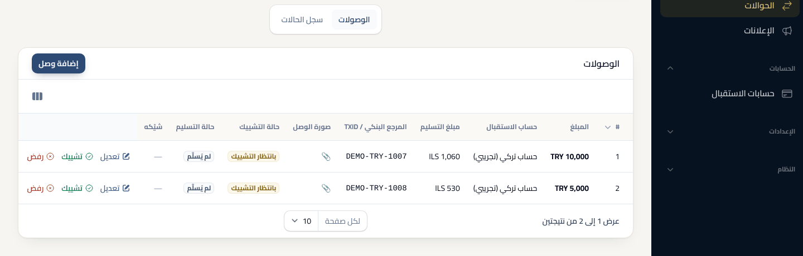<br><sub>وصولات الحوالة: رقم معاملة فريد، وصورة، وتشييك كل وصل</sub></td>
</tr>
<tr>
<td width="50%">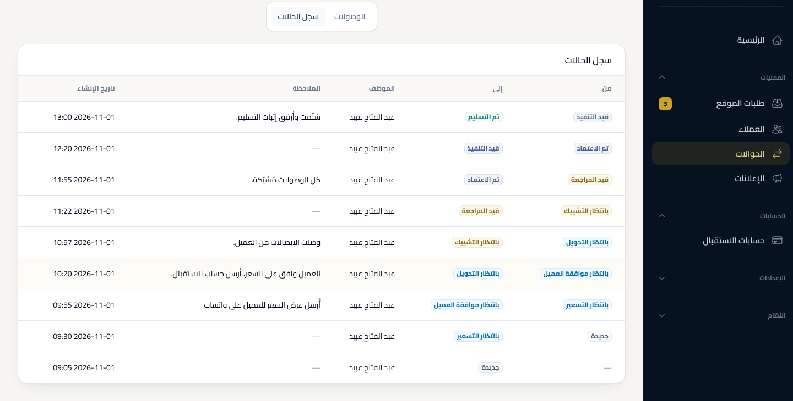<br><sub>سجل الحالات: من نقل الحوالة، ومتى، ولماذا</sub></td>
<td width="50%">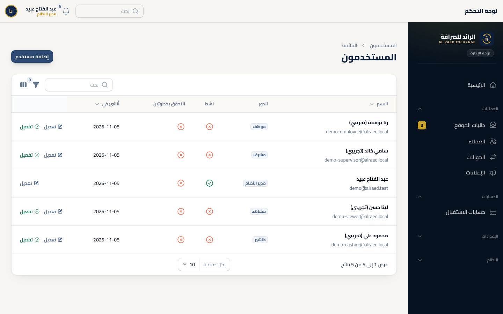<br><sub>المستخدمون: الأدوار، والتفعيل، والتحقق بخطوتين</sub></td>
</tr>
</table>

<p align="center">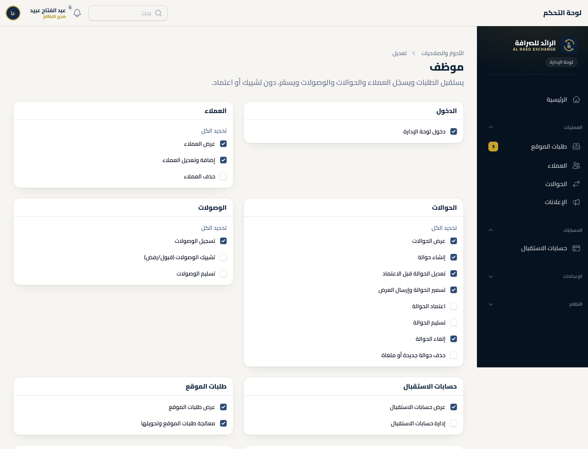<br><sub>تعديل صلاحيات دور «موظف» حسب الأقسام</sub></p>

## كيف يعمل النظام

### خريطة الموقع

<p align="center">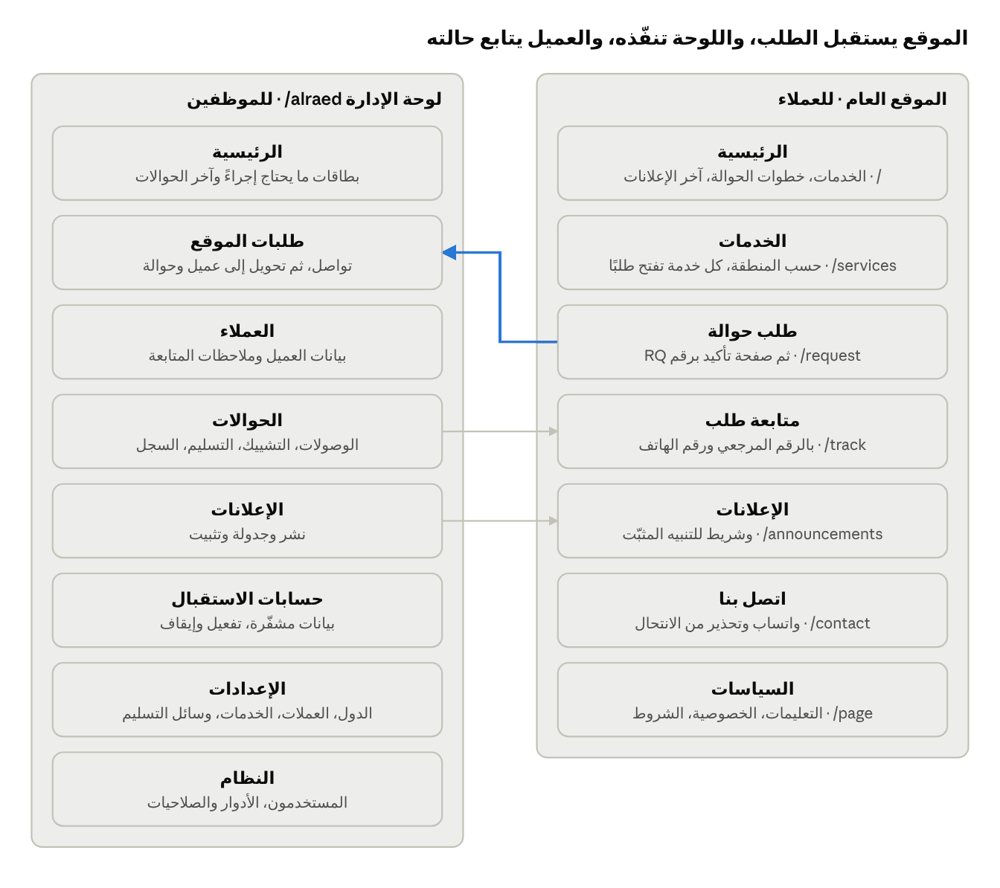</p>

### مسار الحوالة

كل انتقال مسموح فقط من المرحلة السابقة، وبصلاحية الدور المذكور، ويُسجَّل في سجل الحالات.

<p align="center">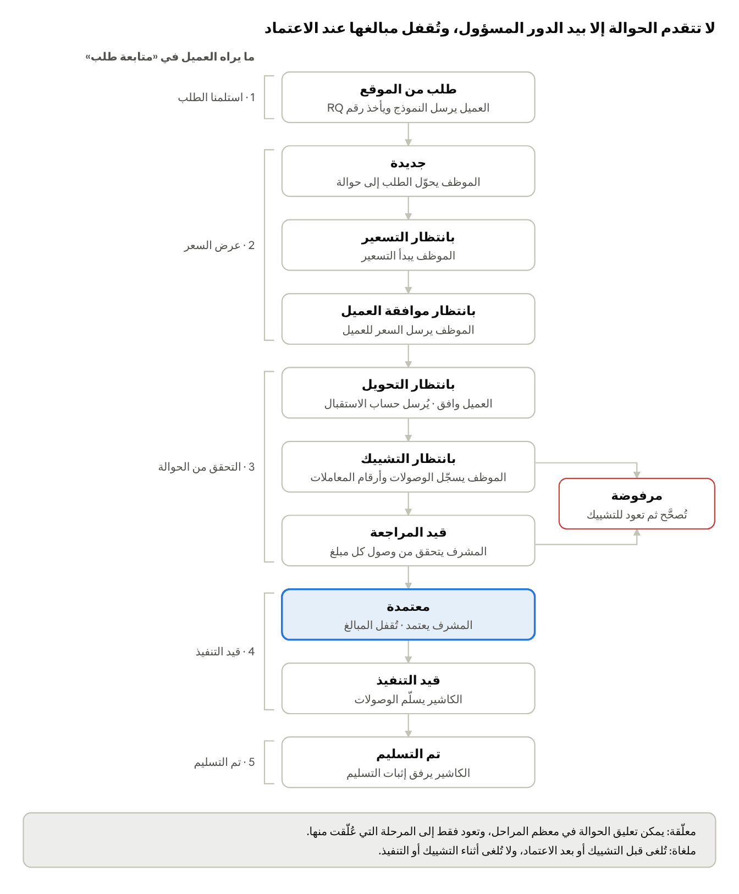</p>

- **معلّقة:** يمكن تعليق الحوالة في معظم المراحل، وتعود فقط إلى المرحلة التي عُلّقت منها.
- **ملغاة:** تُلغى قبل التشييك أو بعد الاعتماد، ولا تُلغى أثناء التشييك أو التنفيذ.
- **ما يراه العميل في «متابعة طلب»:** خمس مراحل فقط: استلمنا الطلب، وعرض السعر، والتحقق من الحوالة، وقيد التنفيذ، وتم التسليم. لا تظهر له أي تفاصيل داخلية.

### الإشعارات

تظهر في جرس اللوحة كل 30 ثانية، بلغة المستلم، ومعها زر «فتح». لا تصل لمن نفّذ الإجراء، ولا للحسابات المعطّلة.

| الحدث | من يصله |
| --- | --- |
| طلب جديد من الموقع | من يعالج طلبات الموقع |
| حوالة بانتظار التشييك | من يشيّك الوصولات |
| حوالة معتمدة جاهزة للتسليم | من يسلّم |
| رفض أو تعليق أو تسليم | منشئ الحوالة والموظف المسؤول عنها |
| إسناد حوالة | الموظف المُسنَد إليه |

## الأدوار والصلاحيات

من يسجّل الوصل لا يشيّكه: الموظف يسجّل، والمشرف يشيّك ويعتمد، والكاشير يسلّم. المدير يعدّل صلاحيات أي دور، عدا دوره هو، من **النظام ← الأدوار والصلاحيات**.

| الدور | يستطيع | لا يستطيع |
| --- | --- | --- |
| مدير النظام | كل شيء، بما فيه المستخدمون والأدوار | تغيير دوره أو تعطيل حسابه بنفسه |
| مشرف | التشييك، والاعتماد، والتسليم، والإعلانات، والإعدادات | إدارة المستخدمين |
| موظف | طلبات الموقع، والعملاء، وإنشاء الحوالات وتسعيرها، وتسجيل الوصولات | التشييك، والاعتماد، والتسليم |
| كاشير | تسليم الحوالات المعتمدة، وإرفاق إثبات التسليم | الإنشاء، والتسعير، والتشييك |
| مشاهد | الاطلاع فقط | أي تعديل، وفتح الإيصالات |

## قواعد الحماية

القواعد مطبّقة في طبقة النماذج والسياسات، وليس على الشاشة فقط، ولكل قاعدة اختبار آلي.

- **القفل المالي:** بعد الاعتماد لا تتغير المبالغ ولا السعر ولا الأطراف ولا الوصولات. الحوالة المسلّمة أو الملغاة للقراءة فقط.
- **رقم المعاملة (TXID) فريد:** يُوحَّد بحذف المسافات وتكبير الأحرف، فيُرفض تكراره حتى لو كُتب بطريقة مختلفة، وحتى لو حُذف الوصل الأول.
- **لا تسليم مزدوج:** كل تغيير حالة أو تشييك أو تسليم يقفل الصف (`lockForUpdate`) داخل معاملة قاعدة بيانات.
- **المرفقات خاصة:** JPG وPNG وWebP وPDF فقط. تُخزَّن خارج المجلد العام، ولا تُفتح إلا لموظف مسموح له برؤية الحوالة المرتبطة، مع `nosniff` و`sandbox`.
- **الدخول:** التحقق بخطوتين (TOTP) إلزامي. الحساب المعطّل أو الذي بلا دور لا يدخل. لا يمكن تعطيل آخر مدير نشط.
- **البيانات الحساسة مشفّرة:** تفاصيل حسابات الاستقبال وبيانات المستفيدين.
- **الموقع العام:** الرقم المرجعي عشوائي، والمتابعة تحتاج الرقم والهاتف معًا. النموذج محدود بـ 5 طلبات كل 10 دقائق، والمتابعة بـ 10 محاولات في الدقيقة، مع حماية من البوتات (honeypot).
- **السجل لا يُمحى:** سجل الحالات وملاحظات العملاء للإضافة فقط، والموظفون يُعطَّلون ولا يُحذفون.
- **المبالغ عشرية:** أعمدة `decimal` في قاعدة البيانات، ولا تُستخدم أرقام عائمة (float) في أي حساب مالي.

## التقنيات

| الطبقة | المستخدم |
| --- | --- |
| الخادم | PHP 8.3 · Laravel 12 · MySQL / MariaDB |
| لوحة الإدارة | Filament 4 · Livewire 3 |
| الموقع العام | Blade · Tailwind CSS 4 (يُبنى مسبقًا في `public/build`) |
| الصلاحيات | spatie/laravel-permission + Laravel Policies |
| الاختبارات | PHPUnit 11 (67 اختبارًا) |
| الاستضافة | Hostinger (استضافة مشتركة) · GitHub |

## التشغيل على جهازك

<div dir="ltr">

```bash
git clone git@github.com:abdulfatah1996/al-raed-exchange.git && cd al-raed-exchange
composer install
cp .env.example .env && php artisan key:generate
# اضبط في .env: APP_ENV=local, APP_DEBUG=true, DB_*  (وضع ALRAED_REQUIRE_MFA=false للتطوير فقط)
php artisan migrate --seed
php artisan alraed:create-user --role=admin
php artisan alraed:demo-data        # اختياري: بيانات تجريبية
php artisan serve                    # الموقع: http://127.0.0.1:8000  · اللوحة: /alraed
```

</div>

لتعديل تصميم الموقع العام: `npm install && npm run build`، ثم ارفع مجلد `public/build` مع التعديل، لأن الاستضافة لا تشغّل Node.

## أوامر الإدارة

| الأمر | ما يفعله |
| --- | --- |
| `php artisan alraed:create-user --role=admin` | ينشئ حساب موظف أو يحدّثه بدور (admin، supervisor، employee، cashier، viewer). كلمة المرور تُكتب مخفية. |
| `php artisan alraed:demo-data` | يحذف البيانات التشغيلية ويضع بيانات تجريبية واقعية. يطلب كتابة `DELETE`. |
| `php artisan alraed:clear-data` | يحذف كل البيانات التشغيلية والحسابات التجريبية، ويُبقي الموظفين والأدوار والإعدادات. يطلب كتابة `DELETE`. |
| `php artisan test` | يشغّل الاختبارات الآلية. |

> خذ نسخة احتياطية من قاعدة البيانات قبل أي أمر حذف. الطريقة موجودة في [دليل النشر](docs/DEPLOYMENT.md#نسخة-احتياطية-من-قاعدة-البيانات).

## النشر

خطوات النشر على Hostinger، والتحديث، والنسخ الاحتياطي، والتراجع، كلها في **[docs/DEPLOYMENT.md](docs/DEPLOYMENT.md)**.

## بنية المشروع

<div dir="ltr">

```text
app/
├── Console/Commands/        أوامر alraed:* (create-user, demo-data, clear-data)
├── Enums/                   حالات الحوالة والوصل والطلب، وأنواع الحسابات
├── Filament/                لوحة الإدارة: Resources, Pages, Widgets
├── Http/Controllers/Site/   صفحات الموقع العام وطلبات الحوالة والمتابعة
├── Models/                  النماذج، وفيها قواعد سير العمل والقفل المالي
├── Notifications/           StaffNotifier: من يُبلَّغ بكل حدث
├── Policies/                صلاحيات كل نموذج وكل إجراء
└── Support/                 مصفوفة الأدوار والصلاحيات، وأدوات مشتركة
database/migrations/         بنية قاعدة البيانات
database/seeders/            الأدوار، والدول والعملات والخدمات، والبيانات التجريبية
lang/ar · lang/en            كل نصوص الواجهة بالعربية والإنجليزية
resources/views/site/        قوالب الموقع العام
tests/Feature/               اختبارات الصلاحيات وسير العمل والموقع والأوامر
docs/                        دليل النشر ولقطات الشاشة
```

</div>

## ما لم يُبنَ بعد

- **الأسعار والعمولات:** أسعار حسب الخدمة والشريحة وطريقة التسليم مع مدة صلاحية، وعرضها على الموقع. لا يعرض الموقع حاليًا أي أسعار صرف.
- **الصندوق والسيولة ودفتر القيود المزدوجة:** أرصدة العملات والحسابات، وقيود تُنشأ عند الاعتماد والتسليم.
- **التقارير:** الحركة اليومية، والأرباح والعمولات، والحوالات غير المسلّمة.
- **الشعار الرسمي:** الشعار الحالي مؤقت.
- **صفحات السياسات:** مسودات تحتاج مراجعة قانونية.

---

<sub>مستودع خاص. لا توضع فيه أسرار: الملف `.env` وكلمات المرور والمفاتيح خارج Git دائمًا، و`.env.example` بلا قيم حقيقية.</sub>

</div>
